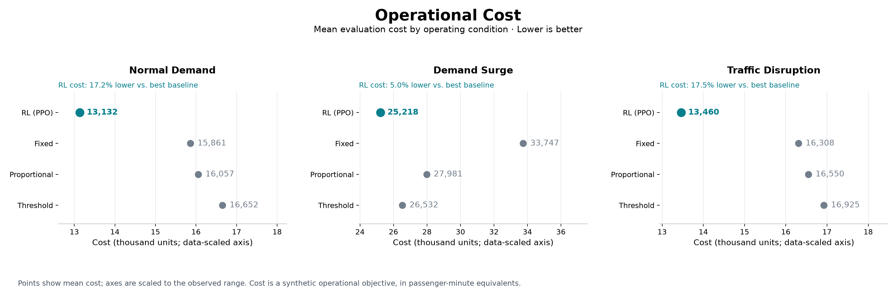
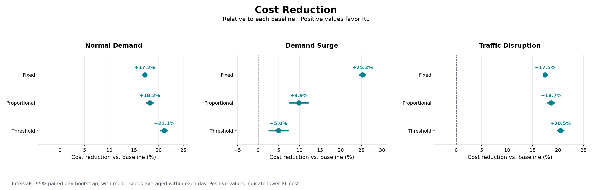
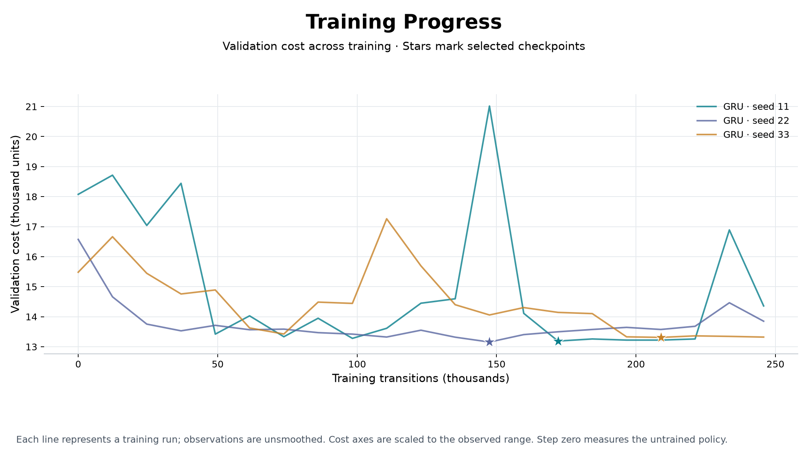
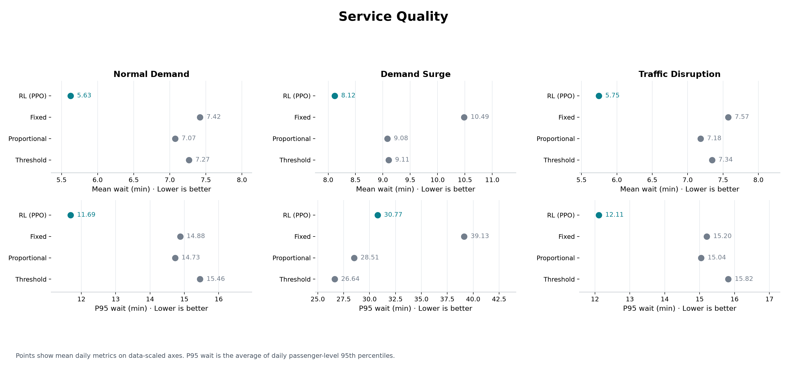

# RL Performance Report

Normal Demand: RL cost is 17.2% lower than the lowest-cost baseline (Fixed), across 200 matched days. The paired cost interval excludes zero.

Demand Surge: RL cost is 5.0% lower than the lowest-cost baseline (Threshold), across 200 matched days. The paired cost interval excludes zero.

Traffic Disruption: RL cost is 17.5% lower than the lowest-cost baseline (Fixed), across 200 matched days. The paired cost interval excludes zero.

Service trade-off in Demand Surge: RL has higher mean daily P95 wait than Proportional, Threshold; lower total cost does not imply improvement on every service metric.

Best-checkpoint validation reduction ranges from 14.0% to 27.0% relative to the measured untrained policy across 3 runs. Negative reductions indicate higher cost. Checkpoints were selected on validation, independently of evaluation scores.

## Operational Cost

Mean daily cost by controller and operating condition. Lower values indicate better performance on the operational objective.

| Condition | Controller | Mean cost ↓ | Days | Training seeds | Seed SD |
|---|---|---|---|---|---|
| Normal Demand | Fixed | 15,861.3 | 200 | — | — |
| Normal Demand | RL (PPO) | 13,132.3 | 200 | 3 | 102.1 |
| Normal Demand | Proportional | 16,056.6 | 200 | — | — |
| Normal Demand | Threshold | 16,652.3 | 200 | — | — |
| Demand Surge | Fixed | 33,747.4 | 200 | — | — |
| Demand Surge | RL (PPO) | 25,218.0 | 200 | 3 | 51.1 |
| Demand Surge | Proportional | 27,980.7 | 200 | — | — |
| Demand Surge | Threshold | 26,531.9 | 200 | — | — |
| Traffic Disruption | Fixed | 16,307.8 | 200 | — | — |
| Traffic Disruption | RL (PPO) | 13,460.0 | 200 | 3 | 89.2 |
| Traffic Disruption | Proportional | 16,549.8 | 200 | — | — |
| Traffic Disruption | Threshold | 16,924.6 | 200 | — | — |

## Cost Reduction

Relative cost reduction against each baseline on identical scenario days. Positive values favor RL; intervals crossing zero are inconclusive.

| Condition | Baseline | RL cost reduction | 95% interval | Paired days | Evidence |
|---|---|---|---|---|---|
| Normal Demand | Fixed | +17.2% | [+17.0%, +17.4%] | 200 | RL lower cost |
| Normal Demand | Proportional | +18.2% | [+17.6%, +18.8%] | 200 | RL lower cost |
| Normal Demand | Threshold | +21.1% | [+20.5%, +21.8%] | 200 | RL lower cost |
| Demand Surge | Fixed | +25.3% | [+24.6%, +26.0%] | 200 | RL lower cost |
| Demand Surge | Proportional | +9.9% | [+7.7%, +12.1%] | 200 | RL lower cost |
| Demand Surge | Threshold | +5.0% | [+2.7%, +7.2%] | 200 | RL lower cost |
| Traffic Disruption | Fixed | +17.5% | [+17.3%, +17.6%] | 200 | RL lower cost |
| Traffic Disruption | Proportional | +18.7% | [+18.0%, +19.3%] | 200 | RL lower cost |
| Traffic Disruption | Threshold | +20.5% | [+19.9%, +21.1%] | 200 | RL lower cost |

## Training Progress

Recorded validation cost across training. Stars mark the lowest-cost checkpoints; historical runs retain their original measurement coverage.

| Model | Reference | Reference cost | Best cost | Reduction | Selected step | Total steps | Validation days |
|---|---|---|---|---|---|---|---|
| GRU · seed 11 | Untrained policy | 18,075.8 | 13,189.8 | 27.0% | 172,032 | 245,760 | 100 |
| GRU · seed 22 | Untrained policy | 16,574.6 | 13,157.2 | 20.6% | 147,456 | 245,760 | 100 |
| GRU · seed 33 | Untrained policy | 15,482.5 | 13,311.8 | 14.0% | 208,896 | 245,760 | 100 |

## Service Quality

Waiting-time outcomes complement the cost objective. Completion, abandonment and unfinished shares expose potential service trade-offs.

| Condition | Controller | Mean wait (min) ↓ | P95 wait (min) ↓ | Completed (%) ↑ | Abandoned (%) ↓ | Unfinished (%) ↓ |
|---|---|---|---|---|---|---|
| Normal Demand | Fixed | 7.42 | 14.88 | 100.00 | 0.00 | 0.00 |
| Normal Demand | RL (PPO) | 5.63 | 11.69 | 100.00 | 0.00 | 0.00 |
| Normal Demand | Proportional | 7.07 | 14.73 | 99.64 | 0.00 | 0.36 |
| Normal Demand | Threshold | 7.27 | 15.46 | 99.58 | 0.00 | 0.42 |
| Demand Surge | Fixed | 10.49 | 39.13 | 95.35 | 4.65 | 0.00 |
| Demand Surge | RL (PPO) | 8.12 | 30.77 | 98.21 | 1.79 | 0.00 |
| Demand Surge | Proportional | 9.08 | 28.51 | 97.56 | 1.82 | 0.62 |
| Demand Surge | Threshold | 9.11 | 26.64 | 98.59 | 0.90 | 0.52 |
| Traffic Disruption | Fixed | 7.57 | 15.20 | 100.00 | 0.00 | 0.00 |
| Traffic Disruption | RL (PPO) | 5.75 | 12.11 | 100.00 | 0.00 | 0.00 |
| Traffic Disruption | Proportional | 7.18 | 15.04 | 99.55 | 0.00 | 0.45 |
| Traffic Disruption | Threshold | 7.34 | 15.82 | 99.63 | 0.00 | 0.37 |

## Experimental Context

RL uses a learned MaskablePPO controller. Fixed follows a fixed schedule; Proportional responds proportionally to observed demand; Threshold activates control at configured thresholds. Exact policy architecture, memory window, training budget and checkpoint identity are recorded in provenance/config.json when available.

| Seed | Encoder | History (min) | Train steps | Train days | Validation days | Routes | Buses | Parameters |
|---|---|---|---|---|---|---|---|---|
| 11 | GRU | 10 | 245,760 | 500 | 100 | 3 | 12 | 449,478 |
| 22 | GRU | 10 | 245,760 | 500 | 100 | 3 | 12 | 449,478 |
| 33 | GRU | 10 | 245,760 | 500 | 100 | 3 | 12 | 449,478 |

Evaluation metadata coverage: **recorded**.

## Methodology

Operational cost is a synthetic, core-weighted objective in passenger-minute equivalents. Controllers are compared within each operating condition. Model seeds are averaged per scenario day before averaging days. Cost reduction is 100 × (baseline − RL) / baseline. Intervals use 2,000 paired day-bootstrap resamples (seed 6001), recomputing the percentage ratio on each resample. They exclude training-seed uncertainty and are not adjusted for multiple comparisons. At least two matched days are required for an interval; small samples remain exploratory. Point charts use explicitly labelled data-scaled axes.

Machine-readable tables: `tables/summary.csv`, `tables/comparisons.csv`, `tables/training.csv`. Source hashes and configuration: `provenance/`. Trace illustrations, when supplied: `figures/diagnostics/`.
